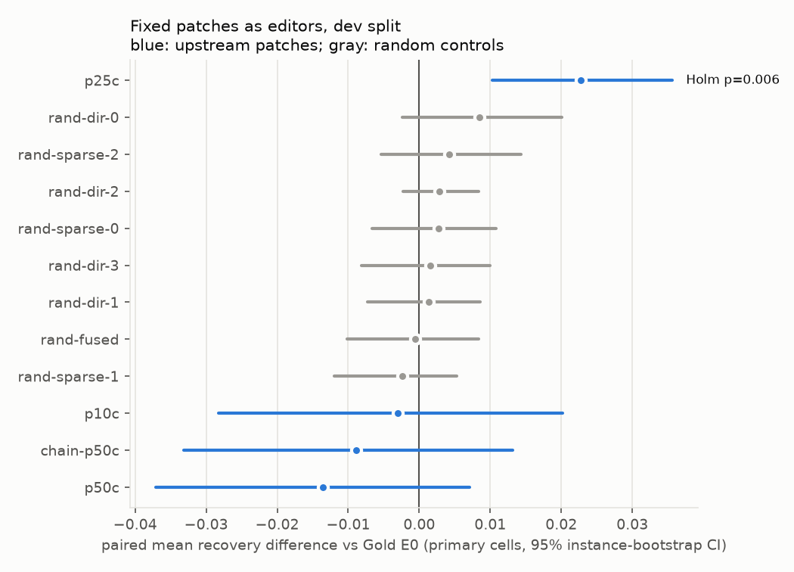
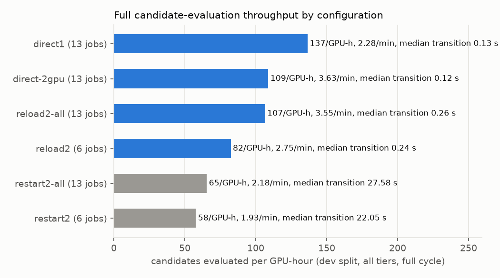

# Phase D v2 end-to-end evaluation: 13 editors, persistent swap, throughput (Workstreams B/C)

Campaigns:
- `20261103T-phaseD-v2-e2e`: dev split, direct mode, 2 GPUs.
- `…-e2e-direct1`: direct mode, 1 GPU.
- `…-e2e-reload2-all` and `…-e2e-restart2-all`: 13 editors on 2 GPUs.
- `…-e2e-reload2` and `…-e2e-restart2`: the first 6-editor attempts.
- `20261103T-phaseD-v2-select`: select split, direct mode, 2 GPUs.

Compact results are in [results/](results/), figures in [figures/](figures/), and row-level evidence in
`evidence/<campaign>/{raw,logs}/`. The benchmark, protocol and engine settings are those frozen in
[../../configs/phaseD_v2/protocol_v2_frozen.json](../../configs/phaseD_v2/protocol_v2_frozen.json).
**No held-out split (test, transfer) was evaluated.**

## Setup

- **Editors** ([../../configs/phaseD_v2/editors.json](../../configs/phaseD_v2/editors.json)): Gold E0 and the 12
  fixed population patches applied to Gold.
  - Upstream patches: p50c, p25c, p10c.
  - Random controls: 4 random directions with p50c's per-tensor norms, 3 random sparse patches, and 1 random patch
    touching a fused tensor, which exercises the reload fallback.
  - chain-p50c, a lineage test.
  - These are *not* editor-designed candidates. They test the integration and give a null distribution of
    "arbitrary weight change" effects on editing ability.
- **Pipeline per job**, one candidate on one split with all tiers (dev: 104 instances, 1664 samples):
  1. Engine transition, with prefix-cache reset and hash verification.
  2. Round-1 generation.
  3. T2P probe feedback, using a second CPU scorer.
  4. Round-2 generation.
  5. CPU scoring and persistence in a thread that overlaps the next job's generation.
- **Workers.** One `wse.pd2_eval worker` per GPU claims jobs from a file queue by atomic rename, so future parents
  can submit candidates the same way. Each worker returns its engine to Gold and runs a full fingerprint audit at
  the end.

## Editor results

### Dev split (exploration)

Gold E0 scores −0.122 [−0.162, −0.084], with valid rate 0.71 and regression rate 0.31. The improved heuristic
scores 0.75 and the oracle 1.00 ([results/editor_results_dev.json](results/editor_results_dev.json)). The primary
endpoint is the paired candidate − E0 difference over the 15 primary cells, Holm-corrected across 12 candidates:

| candidate | Δ vs E0 | 95% CI | Holm p |
|---|---|---|---|
| p25c | **+0.023** | [+0.010, +0.036] | **0.006** |
| rand-dir-0 | +0.009 | [−0.002, +0.020] | 1.0 |
| other 7 random controls | −0.002 … +0.004 | all include 0 | 1.0 |
| p10c / chain-p50c / p50c | −0.003 / −0.009 / −0.014 | all include 0 | 1.0 |

p25c's dev gain is a reduction of harm: T2 validity rose from 0.53 to 0.64 and the regression rate fell from 0.31
to 0.30. It is not repairs: the T2 effective rate is 0.002. It is spread over F1, F2 and F4.

### Select split (confirmation of the dev observation) — negative result

E0 scores −0.114 there. **p25c − E0 = +0.0005 [−0.012, +0.013], Holm p 1.0**
([results/editor_results_select.json](results/editor_results_select.json),
[figures/primary_endpoint_select.png](figures/primary_endpoint_select.png)). No candidate differs from E0 after
correction. The strongest uncorrected effect is rand-dir-2 at −0.008 (p 0.02, Holm 0.23).

**Conclusion.** The dev result for p25c was a selection or noise effect. It survived a 12-candidate Holm
correction on dev but did not replicate on independent instances. None of the fixed patches, upstream or random,
changes Qwen3.5-0.8B's ability to edit networks. This is the expected null for patches not designed for editing,
and it shows why a candidate must be confirmed on a split it was not selected on. The pipeline would have caught
this false positive before the held-out test.



## Throughput (full cycle, dev split, 13 jobs per configuration)

| configuration | candidates/min | candidates/GPU-hour | median transition | median GPU path per job | transition total |
|---|---|---|---|---|---|
| direct, 2 GPUs | **3.63** | 109 | 0.12 s | 29.0 s | 6.4 s |
| reload, 2 GPUs | 3.55 | 107 | 0.26 s | 28.9 s | 5.8 s |
| restart, 2 GPUs | 2.18 | 66 | 27.6 s | 54.2 s | 315 s |
| direct, 1 GPU | 2.28 | 137 | 0.13 s | 25.7 s | 5.4 s |
| select split: direct, 2 GPUs | 3.78 | 114 | | | |

The GPU path per job covers claim through generation complete: transition, round-1 generation, feedback and
round 2. Wall time runs from the first claim to the last completion. The one-time engine start (16 s, 20 s
including init) is excluded and reported in the JSON files. All 13 worker final audits (7 campaigns) passed, and no job failed.



- **Persistent swap vs restart.** Direct is 1.66× and reload 1.63× faster than restart at the same population and
  GPU count. Restart spends a median 27.6 s per candidate rebuilding the engine. That is as long as the whole
  evaluation of a candidate with direct patching, where the transition is 0.4% of the GPU path.
- **Direct vs reload.** Direct and reload are within 2% of each other at this scale. Generation dominates the
  ~29 s per candidate, so the 0.1 s difference in transition is immaterial. Reload additionally writes a 1.5 GB
  checkpoint per candidate (work/derived/candidates, about 16 GB for this population). Direct needs no disk
  checkpoint and is the default. Reload remains the automatic fallback for fused tensors.
- **Two GPUs vs one.** Two GPUs give 1.59× the throughput of one (scaling efficiency 0.80). The per-job GPU path
  rises from 25.7 s to 29.0 s and generation from 14.8 s to 15.6 s with two workers. Scoring medians also rise from
  2.7 s to 4.6 s. These rises point to host CPU contention: 4 scorer processes with F4's episode pools on 32 cores,
  plus the vLLM front-ends. The tail of an odd job count (7 + 6) also contributes. This is a measured inference,
  not isolated by a separate experiment.
- **Early 6-job attempts** (reload2 at 82/GPU-h, restart2 at 58/GPU-h) are retained but not comparable. With 6 jobs
  on 2 workers the non-overlapped scoring of the last jobs dominates: end-to-end medians are 75 s.
- **What this means for a four-parent experiment.** With the parent budget in the design (≤ 30 editor-evaluation
  passes per parent, each a dev-split pass), 4 × 30 = 120 candidate passes take about 33 min on 2 GPUs in direct
  mode, or about 55 min with restarts. Held-out evaluation of 4 candidates plus E0 on test (200 instances, about
  2× dev) is a few minutes.

## Robustness fix during the runs

In the first restart-mode run one worker exited with rc 1 after its work was persisted. The scorer subprocess took
more than 30 s to tear down its episode pool. `Scorer.close()` now kills the scorer after the timeout. The
follow-up runs ended with rc 0. No result was affected: the worker log, summaries and final audit are written
before the scorer is closed.

## Limitations

- The population consists of fixed patches. No editor-designed candidate exists yet, so these results validate the
  machinery and establish the null, not an editing improvement.
- Each throughput configuration was measured once, on 13 jobs. Run-to-run variation of wall time was not measured.
  The equal-population restart, reload and direct runs differ by far more than the 2% direct–reload gap, which
  should be read as a tie.
- Scoring on the CPU is the next bottleneck for scaling past 2 GPUs. F4 episodes are the costliest part.

## Reproduction

See [../../reproduce.md](../../reproduce.md) §10. The commands used:

```bash
# dev, direct, 2 GPUs (campaign 20261103T-phaseD-v2-e2e, job prefix d2_)
PYTHONPATH=. ../work/envs/vllm/bin/python -m wse.pd2_eval submit --queue $Q --editors $EDS --split dev --prefix d2_
CAMPAIGN=20261103T-phaseD-v2-e2e QUEUE=$Q GPUS="0 1" scripts/run_pd2_workers.sh
# mode / GPU-count comparisons (one campaign each)
scripts/run_pd2_throughput_modes.sh                                   # restart2, reload2 (6 editors), direct1
RUNS="restart2-all reload2-all" scripts/run_pd2_throughput_modes.sh   # 13 editors
# select split confirmation (campaign 20261103T-phaseD-v2-select), then pd2_report / pd2_throughput / pd2_figures
```
