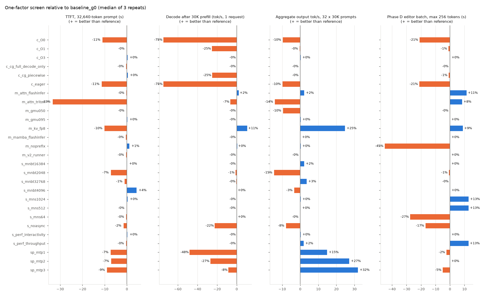
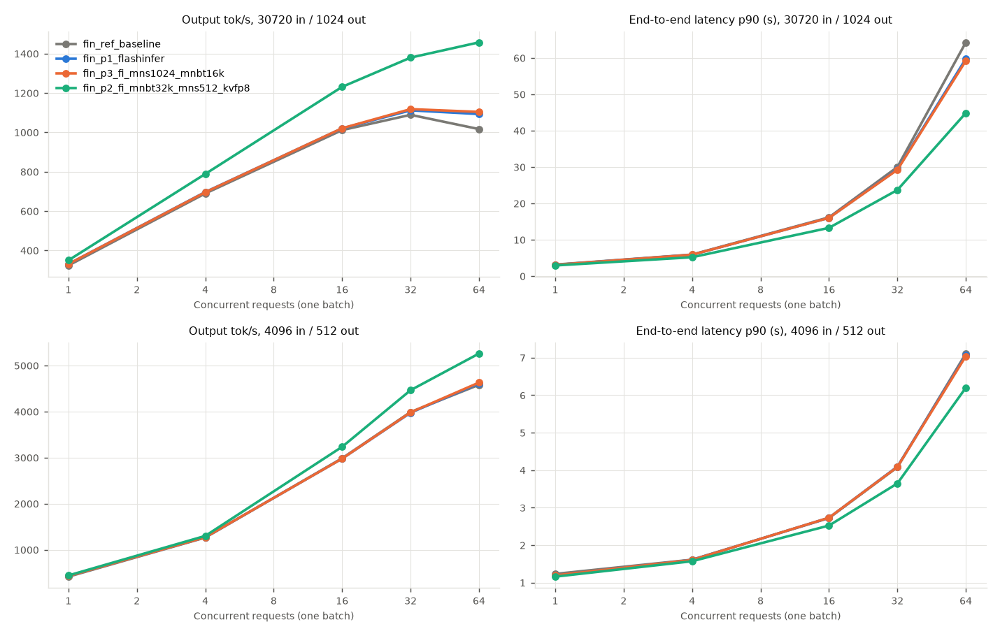
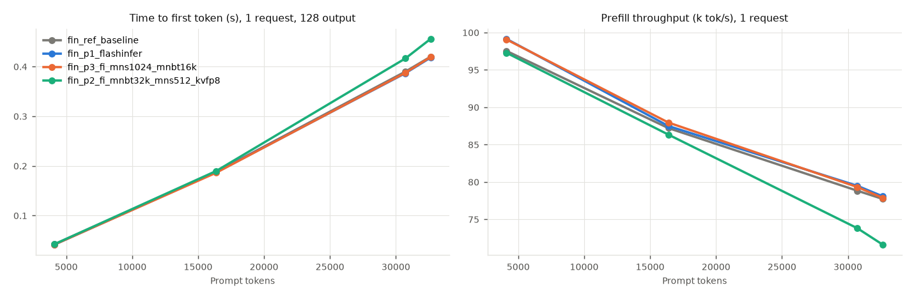
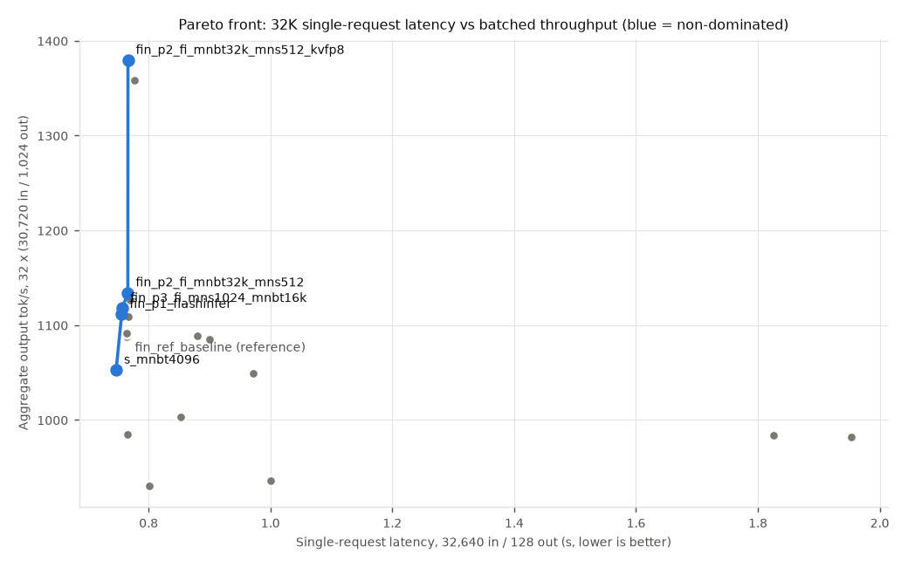

# vLLM inference optimization for Qwen3.5-0.8B BF16 at 32K context (2 × RTX 4090)

Campaign `20261103T-vllm-perf-32k`.
- Protocol: [protocol.json](protocol.json).
- Environment: [results/env/environment.json](results/env/environment.json).
- Compact results: [results/](results/).
- Raw per-repeat rows and logs: `evidence/20261103T-vllm-perf-32k/` (gzip text).

## Question

Which supported vLLM 0.33.0 settings make Qwen3.5-0.8B (BF16, hybrid Gated-DeltaNet/attention) fastest on this
machine without changing experimental semantics? The study covers:
- a single 32K request;
- batched 32K throughput;
- the actual Phase D weight-editor workload.

This is runtime tuning only: weights, tokenizer, prompts, sampling and scoring are untouched.

## Setup

- **Hardware.**
  - 2× RTX 4090 24 GB on PCIe Gen4 x8, no P2P.
  - Driver 615.71.09.
  - Ryzen 9 7950X3D.
  - Both cards were in the **tensor-unlocked state** (gpu-unlock-ada; RM `fmla32=0` on both, verified at the start). Absolute numbers are for unlocked cards. No stock-state vLLM comparison was made, because that needs a reboot. A PyTorch GEMM probe on idle cards ([results/env/gemm_probe.jsonl](results/env/gemm_probe.jsonl)) gave TF32 147 TFLOPS (stock spec about 83, consistent with the unlock), BF16→FP32 153–155 TFLOPS and copy bandwidth 916–919 GB/s.
- **Software.** vLLM 0.33.0, torch 2.14.0+cu130, Triton 3.8.0, FlashInfer 0.7.2.post1. The installed environment was verified identical to `configs/requirements-vllm.lock.txt`; no upgrades were made.
- **Model.** `work/derived/qwen3.5-0.8B-text-gold`, the Phase A text export of Qwen/Qwen3.5-0.8B @ 2fc0636.
  - For MTP only: the same backbone file plus Gold's own `mtp.*` head (`code/bench/add_mtp_head.py`).
- **Harness.** [`code/bench/vllm_bench.py`](../../code/bench/vllm_bench.py) uses the **offline `vllm.LLM` class**, the laboratory's actual path, with no HTTP server.
  - One engine per configuration on one GPU.
  - Startup (`LLM()` construction, including compile and CUDA-graph capture) is timed separately and never enters token rates.
  - Each case runs 1 discarded warm-up, then 2–3 measured repeats.
  - The prefix cache is reset before every repeat, so repeats are independent.
  - TTFT, end-to-end time and per-request decode rate come from vLLM's per-request engine timestamps.
  - Prefix-cache hits and preemptions come from engine counters.
  - VRAM, utilization, power and SM clock come from NVML at 50 ms.
- **Inputs.**
  - Workloads A/B/D/E use fixed seeded token IDs, so context lengths are exact and identical for every configuration. Decoding is greedy with `ignore_eos`, so output lengths are exact.
  - Workloads C/P render the real Phase D pilot prompts: 144 prompts × 4 samples, the pilot's sampling and seed, free-form and grammar-constrained.

| Workload | Content |
|---|---|
| A (prefill) | 1 request, 4,096 / 16,384 / 30,720 / 32,640 input + 128 output |
| B (long generation) | 1 request, 16,384 + 2,048 and 30,720 + 2,048 |
| C (weight editor) | Phase D pilot prompts, n = 4, free-form with max 64 / 256 / 1,024 tokens, and constrained (choice / DSL regex) with max 256 |
| D (concurrency) | 1–64 requests in one `generate()`; 30,720 + 1,024 (32K) and 4,096 + 512 |
| E (shared prefix) | 16 × 16,384-token prompts: unique, identical, or a 12,288-token shared prefix with unique suffixes; 64 output |
| F (two GPUs) | baseline solo on GPU0 vs both GPUs at once vs one TP=2 engine |
| P (pilot exact) | the original pilot settings (max 4,096 tokens, `max_model_len` 7,168) for a bit-exact reproduction check |

- **Search strategy** (adaptive, not a Cartesian product):
  1. Stage 0: baseline on both GPUs, plus a cold-cache start.
  2. Stage 1: one-factor screen, 28 configurations, A–E, 3 repeats.
  3. Stage 2: combined finalists against a fresh baseline, 2 repeats, D extended to 64.
  4. Stage 3: hold-out check on workload mixes *not used for selection* (D at 16,384 + 2,048 and 8,192 + 256, concurrency 2/24; the exact pilot P).

## Baseline (vLLM defaults; `dtype=bfloat16, max_model_len=32768, gpu_memory_utilization=0.85, seed=0`)

Resolved by vLLM:
- `max_num_batched_tokens` 8,192 and `max_num_seqs` 256;
- chunked prefill on and async scheduling on;
- prefix caching on, which puts Mamba/GDN in `align` mode, block 544;
- CUDA graphs `FULL_AND_PIECEWISE` (-O2);
- FLASH_ATTN attention and the Triton GDN kernels;
- KV capacity 1,342,998 tokens (41 × 32K).

| Single request | 4K | 16K | 30K | 32,640 |
|---|---|---|---|---|
| TTFT (s) | 0.042 | 0.188 | 0.390 | 0.420 |
| Prefill (k tok/s) | 98 | 87 | 79 | 78 |
| Decode after prefill (tok/s) | 430 | 400 | 371 | 369 |

- **Stability.**
  - Run-to-run coefficient of variation is ≤ 0.3% in almost every case.
  - The two GPUs agree within 0.7% (`baseline_g0` vs `baseline_g1`) and produce identical outputs.
  - With unchanged configuration, greedy and seeded-sampling outputs are identical across repeats and across GPUs.
  - Exceptions: some 4,096-token D batches, and the 30,720 A case between a cold-compiled and a cache-loaded engine.
- **Startup.**
  - Warm compile cache: 19 s. This breaks down into model load 2.3 s, torch.compile cache load 0.25 s, CUDA-graph capture 4 s twice, and profiling/KV allocation.
  - **Cold cache: 121 s.** About 100 s of this is Triton/Inductor JIT. Keep `VLLM_CACHE_ROOT`/`TRITON_CACHE_DIR`/`TORCHINDUCTOR_CACHE_DIR` persistent.
- **Pilot reproduction.** With the exact pilot settings, this harness regenerates the committed Phase D pilot outputs **bit-for-bit**: 576/576 identical texts, both free-form and constrained ([results/output_equivalence.json](results/output_equivalence.json)).

## One-factor screen (Stage 1; relative to baseline, + = better)

| Change | Effect | Verdict |
|---|---|---|
| `enforce_eager` / `-O0` | decode −75%, 4K D@32 −47%, editor −15 to −21%; startup 9 s | never for measurement runs |
| `-O1` or `cudagraph_mode=PIECEWISE` (no full graphs) | decode −25% at concurrency 1, other cases ≈ 0 | keep FULL_AND_PIECEWISE |
| `FULL_DECODE_ONLY`, `-O3` | ≈ 0 | — |
| `async_scheduling=False` | decode −22%, TTFT(4K) −15%, editor −13 to −18% | keep async (default) |
| `max_num_batched_tokens` 2,048 | TTFT(4K) −33%, D@32×30K −15% | too small |
| 4,096 / 16,384 / 32,768 | ±0–4%; 32,768 gives D@32×30K +3.5% | 16,384 is a safe gain (see VRAM below) |
| chunked prefill off | **refused**: "Chunked prefill is required for Mamba prefix caching" | not available with prefix caching |
| `max_num_seqs` 64 | editor −27% (576 sequences queue) | — |
| `max_num_seqs` 512 / 1,024 or `performance_mode=throughput` | editor +13% (free 256), +2.5% constrained, +6% (1,024) | all 576 Phase D sequences in one batch |
| `performance_mode=interactivity` | ≈ 0 | — |
| `gpu_memory_utilization` 0.50 | KV 0.69M tokens; D@32×30K −9.6% (requests queue) | — |
| `gpu_memory_utilization` 0.95 | KV 1.53M; ≈ 0 at ≤ 32 requests | not needed below 41 × 32K |
| prefix caching off | editor **−45% (free) / −61% (constrained)**, shared-prefix E −58 / −86% | must stay on |
| `attention_backend=FLASHINFER` | editor +6 to +11%, decode +2%, D +2% | adopt |
| `attention_backend=TRITON_ATTN` | TTFT(32K) −33%, E −23% | reject |
| `mamba_backend=flashinfer` | ≈ 0 | — |
| `VLLM_USE_V2_MODEL_RUNNER=1` | ≈ 0, outputs identical | — |
| `kv_cache_dtype=fp8` | D@32×30K +25%, decode +5 to +9%, editor +3 to +9%, KV ×1.66; **changes outputs** | optional, not semantics-preserving |
| MTP speculative (1/2/3 draft tokens) | single request **slower** (−8 to −45%); editor not faster (0 to −13%); synthetic D +15 to +37% | reject (see below) |

**MTP is rejected.**
- At concurrency 1 it is slower for 16–32K contexts at every draft depth: decode 194 / 272 / 340 tok/s against 370 without MTP.
- On the real editor prompts the acceptance rate is 58–90% and wall time does not improve.
- Its gains on synthetic batched D are an artefact. Greedy decoding of random-token prompts falls into repetitive continuations, which the drafter predicts at 98–99.9% acceptance; real text gives 58–90%.

## Finalists (Stage 2, fresh baseline in the same stage; 2 repeats)

| Config | TTFT 32,640 | decode 30K (tok/s) | D 32×30K total tok/s | D 64×30K | editor free 256 (s) | constrained 256 (s) | free 1,024 (s) | NVML VRAM peak | KV tokens |
|---|---|---|---|---|---|---|---|---|---|
| baseline | 0.420 | 369.3 | 33,758 | 31,511 (6 preemptions) | 8.92 | 3.82 | 20.29 | 21.7 GB | 1.34M |
| P1: FlashInfer | 0.418 | 377.9 (+2.3%) | 34,461 (+2.1%) | 33,882 | 8.01 (+11%) | 3.61 (+6%) | 18.88 (+7%) | 22.0 GB | 1.32M |
| FlashInfer + mnbt 16,384 + mns 1,024 | 0.419 | 377.5 (+2.2%) | 34,657 (+2.7%) | 34,219 | **7.67 (+16%)** | **3.58 (+7%)** | **18.81 (+8%)** | 20.6 GB | 1.05M |
| FlashInfer + mnbt 32,768 + mns 512 | 0.428 | 376.1 | 35,164 (+4.2%) | 34,440 | 7.67 | 3.58 | 18.82 | **24.3 GB** (of 24.5) | 1.21M |
| … + `kv_cache_dtype=fp8` | 0.456 (−8%) | 408.6 (+11%) | **42,767 (+27%)** | **45,172 (+43%)**, 0 preemptions | 7.80 | 3.70 | 18.69 | 24.4 GB | 2.23M |
| … + `gpu_memory_utilization=0.92` | **OOM** on the first 30K prefill (GDN chunk kernel) | | | | | | | | |

Pareto front (32,640-token single-request latency against 32 × 32K throughput; MTP excluded): `s_mnbt4096` (lowest latency, −3% throughput) → FlashInfer → FlashInfer + scheduler → + FP8 KV.

### Concurrency (baseline)

| Requests | 30,720 + 1,024: output / total tok/s | p90 end-to-end (s) | 4,096 + 512: output tok/s | p90 end-to-end (s) |
|---|---|---|---|---|
| 1 | 324 / 10,053 | 3.2 | 415 | 1.23 |
| 4 | 689 / 21,366 | 5.9 | 1,264 | 1.62 |
| 16 | 1,011 / 31,343 | 16.1 | 2,978 | 2.73 |
| 32 | 1,089 / 33,756 | 30.0 | 3,985 | 4.08 |
| 64 | 1,016 / 31,511 (6 preemptions) | 64.3 | 4,581 | 7.11 |

- **32K requests saturate at 16–32 per GPU.** Beyond 16, throughput rises only +8% while latency doubles. At 64 the KV pool (1.34M tokens = 41 × 32K) is exceeded, causing preemption and recomputation, and throughput falls.
- **For 4K + 512 requests,** throughput is still rising at 64 (+15% from 32 to 64).
- **Prefill dominates 32K batches:** 32 × 30,720 prompt tokens take about 13 s of the 30 s.

### Hold-out check (Stage 3; mixes not used for selection)

- **D at 16,384 + 2,048 and 8,192 + 256, concurrency 2/24:** FlashInfer + scheduler finalists are within ±1.2% of the baseline. Their gains do **not** generalize to these shapes.
- **Exact pilot P:** constrained +7.0 to +7.4%, free-form with max 4,096 +2.9%. The free-form run is dominated by a few long, looping samples decoded at small batch size.
- **FP8 KV holds up:** +30% at 24 × (16K + 2K), +15% on the P free-form run.

## Two GPUs (workload F)

| Mode | 32,640 TTFT | decode 30K | D 32×30K total tok/s | startup |
|---|---|---|---|---|
| GPU0 alone | 0.421 | 345 output tok/s (B) | 33,746 | 18 s |
| GPU0 + GPU1 at once (independent engines) | 0.422 / 0.418 | 345 / 346 | 33,734 + 33,826 = **67,560** | 19 s |
| One engine, `tensor_parallel_size=2` | 0.637 (−34%) | 342 | 32,529 (**−52% of two independent engines**) | 69 s |

- **Independent engines.** They show no measurable interference (≤ 0.2%) and scale exactly 2×.
- **TP=2 is worse than a single GPU for 32K prefill and batched work.** Without P2P, activations are all-reduced through host memory; the model is 1.4 GB, so sharding brings nothing.

## Behavioural verification (Phase D outputs; [results/output_equivalence.json](results/output_equivalence.json))

| Change vs baseline | Identical sampled texts | Mean-recovery difference [95% CI] |
|---|---|---|
| other GPU, `max_num_batched_tokens` 32,768, V2 runner | 100% | 0 |
| PIECEWISE graphs | 92–100% | ≤ 0.001 |
| `max_num_seqs` 512 / 1,024 / throughput mode | 57–96% | −0.004 to +0.007, all CIs include 0 |
| FlashInfer attention | 53–89% | −0.010 to +0.005, all CIs include 0 |
| FP8 KV | 39–79% | −0.007 to +0.015, all CIs include 0 |
| MTP 1–3 | 30–48% | −0.043 to +0.037, all CIs include 0 |
| Triton attention / prefix caching off | 51–89% | single cells −0.033 to +0.024 with CIs excluding 0 |

- **Outputs of this engine are not batch-invariant.**
  - Any change in batch composition or kernels shifts floating-point reductions.
  - Under temperature sampling, such a shift flips a token in a fraction of the samples, and those samples then diverge entirely.
  - This is numerical, not a model change: greedy single-request outputs are identical across GPUs and scheduler settings.
- **Phase D outcomes are statistically unchanged.** None of the adopted changes alters the mean recovery measurably.
- **The noise floor of a single n = 64 cell is about ±0.03 recovery.** That is the size of the "significant" single-cell differences seen for Triton attention and for prefix caching off, from numerical nondeterminism alone. Phase D comparisons should therefore be paired under one engine configuration, never across configurations.
- **For bit-exact reproduction of committed results, use the default engine.** The new profiles are opt-in (`--engine-json` in `wse.editor_pilot`); defaults are unchanged.

## Checkpoint swap (Profile 3: repeated candidate evaluations)

[`code/bench/weight_swap.py`](../../code/bench/weight_swap.py) tested whether one engine can evaluate several candidates. The procedure:
1. Start one engine on Gold.
2. Run the editor cases.
3. Call vLLM's in-place `collective_rpc("reload_weights", kwargs={"weights_path": <p50c>})`.
4. Reset the prefix cache.
5. Rerun the editor cases, then swap back to Gold.

At the same time, a fresh engine was started on p50c on the other GPU.

| | Time | C free 256 output hash | C constrained 256 output hash |
|---|---|---|---|
| Fresh engine start (Gold / p50c) | 18.9 s / 26.7 s | 9f506331 / 076d5446 | 3194b0e1 / 53ff83f4 |
| Swap Gold → p50c in the running engine | **0.20 s** | 076d5446 (= fresh p50c) | 53ff83f4 (= fresh p50c) |
| Swap p50c → Gold | **0.19 s** | 9f506331 (= baseline) | 3194b0e1 (= baseline) |

- **In-place reload is bit-exact and about 100× faster than restarting the engine.**
- **Conditions:** checkpoint files in the page cache; same architecture and tensor shapes. Compiled graphs and CUDA graphs stay valid because parameters are overwritten in place.
- **Effect on candidate evaluation:** the per-candidate cost of the 576-sequence constrained evaluation drops from about 23 s (restart + 3.6 s) to about 3.8 s, roughly **6× more candidates per GPU-hour**. This is the largest Profile 3 gain found, larger than any engine flag.
- **Required discipline:** reset the prefix cache after every swap. Cached KV/GDN states belong to the old weights.

## Selected profiles ([configs/vllm_perf/profiles/](../../configs/vllm_perf/profiles/))

| Profile | Settings (in addition to `dtype=bfloat16, max_model_len=32768, gpu_memory_utilization=0.85, seed=0`) | Measured vs baseline | VRAM (NVML peak) / KV | Startup |
|---|---|---|---|---|
| 1. Single request at 32K | `attention_backend=FLASHINFER` (keep defaults: async, chunked 8,192, FULL_AND_PIECEWISE graphs, prefix caching) | decode +2.3% (378 tok/s after a 30K prompt), TTFT ≈ (0.418 s at 32,640) | 22.0 GB / 1.32M | 20 s warm, about 120 s cold |
| 2. Aggregate 32K throughput | FlashInfer + `max_num_batched_tokens=16384, max_num_seqs=1024`; **one engine per GPU** (×2.0) | +2.7% at 32 × 32K, +8.6% at 64 × 32K; 69.3k total tok/s on both GPUs | 20.6 GB / 1.05M | 23 s |
| 2+ (non-equivalent) | same + `kv_cache_dtype=fp8` | +27% (32×) / +43% (64×); ≈ 85k total tok/s on both GPUs | 24.4 GB / 2.23M | 23 s |
| 3. Phase D editor workload | same as profile 2 (FlashInfer, mnbt 16,384, `max_num_seqs` ≥ 576), prefix caching **on** | free 256 +16%, constrained +7%, free 1,024 +8%; exact-pilot hold-out +3 to +7% | 20.6 GB / 1.05M | 23 s |

- Profiles 2 and 3 converge to the same settings. The search found no setting that helps one without the other.
- Profile 2's `max_num_batched_tokens=32768` variant gains another +1.5% but peaks at 24.3 of 24.5 GB. With `gpu_memory_utilization` 0.92 it OOMs, so it is not recommended.

## Conclusions

1. **vLLM 0.33's defaults are already close to optimal for this model and GPU.** The large levers are on by default: async scheduling (+22% decode), full CUDA graphs (+33% decode vs piecewise) and prefix caching (+45 to +61% on the editor workload). Turning any of them off is the main way to lose performance.
2. **Semantics-preserving tuning gives +2 to +16%, depending on workload.** The largest gain, +16%, is on the Phase D editor batch: FlashInfer attention plus all 576 sequences in one batch. Long-context single-request performance improves only +2%.
3. **FP8 KV cache is the only large throughput lever (+27 to +43% at 32K batches),** but it changes outputs. It fits throughput-only studies, not reproduction of BF16-KV results.
4. **Two GPUs: run two independent engines (exactly 2×). Never use TP=2 on this host (no P2P).**
5. **Measured bottlenecks.**
   - Concurrency-1 decode runs at about 2.7 ms per token at 30K (370 tok/s). That is above the weight-streaming bound of about 1.6 ms for 1.4 GB at about 0.9 TB/s.
   - 32K batches are prefill-bound at about 78k tok/s.
   - Phase D free-form time is dominated by the few samples that run to the token cap. The cap, a protocol parameter, matters far more than the engine: max 256 takes 8.9 s, max 4,096 takes 70.8 s.

## Unsupported, failed or negative

- **Chunked prefill off:** refused while prefix caching is on (Mamba align mode).
- **`gpu_memory_utilization` 0.92 with `max_num_batched_tokens` 32,768:** CUDA OOM in the GDN prefill.
- **MTP:** slower at concurrency 1.
- **TP=2:** slower than one GPU.
- **Triton attention:** −33% TTFT at 32K.
- **Out of scope:** stochastic-rounding and bf16 Mamba SSM state were not tested (numerics). No vLLM upgrade was made.
- **Tokenizer backends:** not benchmarked. Prompt tokenization of the 144 editor prompts is not on the critical path (prompts are tokenized once per run).
- **HTTP serving and the `vllm bench sweep` tools:** not used, because the laboratory workload is offline `LLM.generate`.

## Limitations

- **Hardware state.** Cards were tensor-unlocked; the same tuning on stock cards was not measured.
- **Repeats.** 2–3 per case, with very low dispersion (CV ≤ 0.3%). Effects below about 1% are not resolved.
- **Synthetic prompts.** A/B/D/E use random-token prompts. Throughput is content-independent, except speculative-decoding acceptance, which is why MTP is judged on C/P.
- **Single model.** One model and one vLLM version; results may not transfer to p50c-like candidates with different output-length distributions.

## Reproduction

See [reproduce.md §9](../../reproduce.md).
